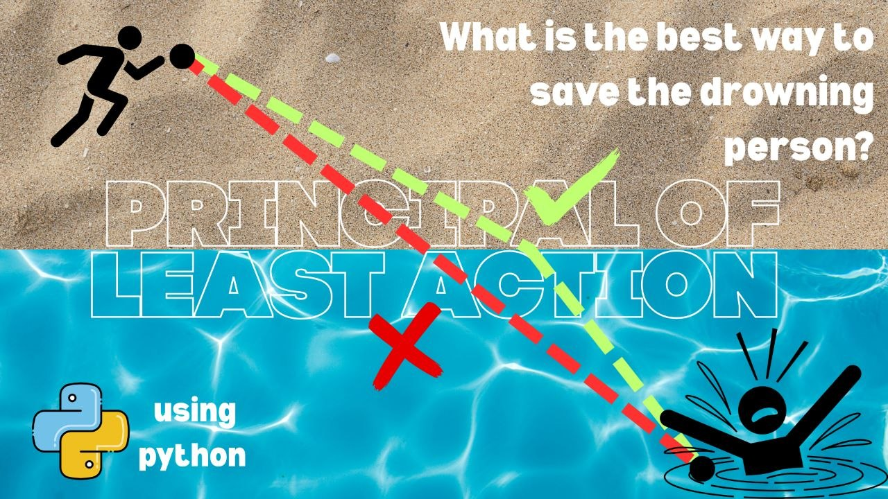

# 🏊 Optimal Land–Water Path: Energy-Based Path Optimization
<!-- Replace images/banner.png with your own main image (recommended width: 800-1200 px) -->
<p align="center">
  
</p>


A physics-based simulation that finds the **best path between a point on land and a point in water** by choosing the optimal crossing point on the shoreline. The path is selected by minimizing an energy-based cost that includes kinetic energy, viscous (drag) losses in water, and the potential energy of an object under buoyancy.

> Inspired by the classic *lifeguard problem* and Fermat's principle of least time, but extended with an energy model instead of a pure travel-time model.

---

## 📸 Preview

<!-- Replace the paths below with your own images -->

| All candidate paths | Best path found |
|:---:|:---:|
|  |  |
| *PLACEHOLDER: all tested crossing points on the shoreline* | *PLACEHOLDER: optimal path (dashed)* |


---

## 📖 Table of Contents

1. [Problem Statement](#-problem-statement)
2. [Mathematical Model](#-mathematical-model)
3. [Analytical Check](#-analytical-check)
4. [Algorithm](#-algorithm)
5. [Installation](#-installation)
6. [Usage](#-usage)
7. [Parameters](#-parameters)
8. [Results](#-results)
9. [Limitations and Future Work](#-limitations-and-future-work)
10. [Author](#-author)

---

## 🎯 Problem Statement

An object of mass $m$ starts at point $B$ **on land** and must reach point $A$ **in water**. The shoreline is the horizontal line $y = 3$. The object crosses the shoreline at a point $Z = (z, 3)$.

- $B = (1, 4)$
- $A = (5, 1)$
- Shoreline: $y = 3$

**Goal:** find the value of $z$ that minimizes the total energy-based cost $S(z)$.

```
        y
        │
      4 │  B ●
        │      \
      3 │───────● Z(z,3)───────  shoreline (land above / water below)
        │          \
      1 │            ● A
        └──────────────────── x
           1        5
```

---

## 🧮 Mathematical Model
 
The object starts at $B = (x_B, y_B)$ on land, crosses the shoreline $y = 3$ at the point $Z = (z, 3)$, and ends at $A = (x_A, y_A)$ in the water.
 
### 1. Path parametrization
 
Each path is made of two straight segments. Each segment is described by a parameter $t \in [0, 1]$.
 
**Land segment $B \to Z$:**
 
$$
x_{BZ}(t) = x_B + (z - x_B)\,t, \qquad
y_{BZ}(t) = y_B + (3 - y_B)\,t
$$
 
**Water segment $Z \to A$:**
 
$$
x_{ZA}(t) = z + (x_A - z)\,t, \qquad
y_{ZA}(t) = 3 + (y_A - 3)\,t
$$
 
### 2. Speeds
 
The speed on each segment is the magnitude of the derivative with respect to $t$, which is the path length covered in one unit of the parameter:
 
$$
v_B = \sqrt{\left(\frac{dx_{BZ}}{dt}\right)^2 + \left(\frac{dy_{BZ}}{dt}\right)^2}
= \sqrt{(z - x_B)^2 + (3 - y_B)^2}
$$
 
$$
v_A = \sqrt{\left(\frac{dx_{ZA}}{dt}\right)^2 + \left(\frac{dy_{ZA}}{dt}\right)^2}
= \sqrt{(x_A - z)^2 + (y_A - 3)^2}
$$
 
### 3. Distance travelled in water
 
$$
d = \sqrt{(x_A - z)^2 + (y_A - 3)^2} = v_A
$$
 
### 4. Kinetic energy
 
On land (no resistance):
 
$$
E_{c,1} = \frac{1}{2}\, m\, v_B^{2}
$$
 
In water (viscous loss proportional to the speed and the distance):
 
$$
E_{c,2} = \frac{1}{2}\, m\, v_A^{2} - k\, v_A\, d
$$
 
Total kinetic term:
 
$$
E_c = E_{c,1} + E_{c,2}
$$
 
### 5. Potential energy (weight and buoyancy)
 
The potential energy is the weight minus the buoyant force, multiplied by the depth:
 
$$
E_{p,\text{land}} = 0
$$
 
$$
E_{p,\text{water}} = h\,(m g - \rho_{w} V g) = g\,h\,\left(m - \rho_{w}\,V\right)
$$
 
$$
E_p = E_{p,\text{land}} + E_{p,\text{water}}
$$
 
With the values used here, $E_p = 9.81 \times 0.25 \times (70 - 250) \approx -441.45$. It is negative because $\rho_w V = 250$ kg is larger than $m = 70$ kg, so the object is lighter than the water it displaces.
 
### 6. Objective function
 
$$
S(z) = E_c(z) - E_p
$$
 
The optimal crossing point is:
 
$$
z^{*} = \underset{z \in [1,\,5]}{\arg\min}\; S(z)
$$
 
---
 
## ✅ Analytical Check

Because $d = v_A$, the water term becomes $\left(\frac{m}{2} - k\right) v_A^2$. Also, $E_p$ does not depend on $z$. Let

$$
a = \frac{m}{2}, \qquad b = \frac{m}{2} - k
$$

Then the objective simplifies to:

$$
S(z) = a\left[(z - x_B)^2 + (3 - y_B)^2\right] + b\left[(x_A - z)^2 + (y_A - 3)^2\right] - E_p
$$

Setting the derivative to zero:

$$
\frac{dS}{dz} = 2a\,(z - x_B) + 2b\,(z - x_A) = 0
$$

Solving for $z$:

$$
\boxed{z^\ast = \frac{a\,x_B + b\,x_A}{a + b}}
$$

Since $\frac{d^2S}{dz^2} = 2(a + b) > 0$, this point is a minimum.

With $m = 70$ kg and $k = 0.25$, we get $a = 35$ and $b = 34.75$:

$$
\boxed{z^\ast = \frac{35 \times 1 + 34.75 \times 5}{35 + 34.75} = \frac{208.75}{69.75} \approx 2.99}
$$

This value is inside the scan range $[1, 5]$, and the minimum cost is:

$$
\boxed{S(z^\ast) \approx 894.45}
$$

This result is used to **validate the numerical scan** (see [Results](#-results)).

---
## ⚙️ Algorithm

1. Define points $A$ and $B$ and the physical constants.
2. Loop over candidate crossing points $z$ from 1 to 5 with a step of 0.1 (skipping $z = x_B$ to avoid a degenerate segment).
3. For each $z$, compute $v_B$, $v_A$, $d$, $E_c$, $E_p$ and $S$.
4. Keep the $z$ with the smallest $S$.
5. Plot all candidate crossing points and highlight the best path with dashed lines.

---

## 🛠 Installation

```bash
git clone https://github.com/<your-username>/<your-repo-name>.git
cd <your-repo-name>
pip install matplotlib sympy
```

**Requirements:** Python 3.9+, `matplotlib`, `sympy`.

---

## ▶️ Usage

```bash
python main.py
```

Expected console output (approximate):

```
the best path is with s = ~894 & z = ~3.0
```

A matplotlib window opens showing the points, the tested crossing points, and the best path.

---

## 🔧 Parameters

| Symbol | Variable | Value | Description |
|:---:|:---:|:---:|:---|
| $m$ | `m` | 70.0 kg | Mass of the object |
| $V$ | `V` | 0.25 m³ | Volume of the object |
| $h$ | `h` | 0.25 m | Depth in water |
| $g$ | `g` | 9.81 m/s² | Gravity |
| $\rho_w$ | `rho_water` | 1000 kg/m³ | Density of water |
| $k$ | `k` | 0.25 | Viscosity coefficient |
| $A$ | `A` | (5, 1) | Destination in water |
| $B$ | `B` | (1, 4) | Start on land |
| – | `3` | y = 3 | Shoreline height |

Change these values at the top of the script to test other scenarios.

---
## 📊 Results

<!-- Add your own result images and notes here -->

| Method | Optimal $z$ |
|:---|:---:|
| Numerical scan (step 0.1) | ≈ 3.0 |
| Analytical solution | ≈ 2.99 |

The numerical result agrees with the analytical solution within the scan resolution.

### All tested paths

<p align="center">
  
  <br/>
  <em>PLACEHOLDER: all candidate crossing points on the shoreline</em>
</p>

### Best path

<p align="center">
  
  <br/>
  <em>PLACEHOLDER: final figure with the best path highlighted (dashed)</em>
</p>

---

## 🚧 Limitations and Future Work

- The scan uses a fixed step of 0.1, so the precision is limited. A finer step or `scipy.optimize.minimize_scalar` would give an exact result.
- The "velocity" is the path length for $t \in [0,1]$ (unit time), not a physical speed in m/s. Adding real travel time would make the model more realistic.
- The potential energy term is constant in $z$, so it does not affect the optimal path.
- Floating-point accumulation in the `while` loop can be avoided with `numpy.arange` or `numpy.linspace`.
- Possible extensions: curved shorelines, variable depth, a time-based cost (Snell's law comparison), interactive sliders.

---

## 👤 Author

**Abderraouf Brada**
4th-year student, Micro and Nano Sensors and Instrumentation
National School of Nanosciences and Nanotechnology, Algeria

GitHub: [@your-username](https://github.com/your-username)

---

## 📄 License

This project is released under the MIT License. See [LICENSE](LICENSE) for details.
